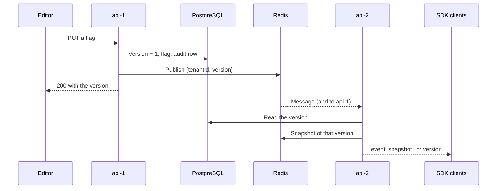

# realtime-feature-flags

[](https://github.com/realjoegz/realtime-feature-flags/actions/workflows/ci.yml)

A multi-tenant feature flag service in TypeScript on Node 24.13.0: a NestJS 12.1.3 API on PostgreSQL 18.6 and Redis 8.10.2, an SDK that receives changes over server-sent events and evaluates flags locally, and a Next.js 16.4.1 dashboard that signs users in through Dex v2.46.0. Flags have targeting rules and percentage rollouts. Two choices shape the design. PostgreSQL row-level security keeps tenants apart, and the API refuses to start as a database role that could skip it. And Redis notifications are only hints: a notification says which tenant to read, and when one is lost, a poll and the read when a stream opens still bring every client to the latest version in PostgreSQL. Every claim in the proof tables is tied to a test: each row links the tests that prove it, and the build fails if a linked test did not run and pass.

## Proofs

Four rows, cut to their main claims. [docs/evidence.md](docs/evidence.md) has all 63 and, before each table, says how its tests force their cases.

| Proof | Proven behaviour | Test |
|---|---|---|
| Rollout | Raising the percentage only adds users; lowering and raising it again restores the same users | [P2 raising the percentage only adds users (seed 20261014, 1000 runs)](packages/core/test/rollout.test.ts), [P4 lowering then raising the percentage restores the same users (seed 20261014, 500 runs)](packages/core/test/rollout.test.ts) |
| Isolation | Acting for tenant B, the API's database role reads only B's rows in every table; on every route under `/tenants/:tenantId`, a member of B sending A's request gets the reply for something that does not exist | [tenant isolation in the tables in B's context rff_app reads exactly B's rows from every table](apps/api/test/isolation-tables.test.ts), [tenant isolation at the routes each case: a member of A succeeds in A, and a member of B making the same request is refused exactly as for a tenant or resource that does not exist](apps/api/test/isolation-routes.test.ts) |
| Convergence | With every Redis notification lost, SDK clients moving between two API instances in one test process end on the database's flags and version, applying only increasing versions | [convergence on two instances every notification lost: 4 SDK clients moving between two apps end on the database's flags and version and apply strictly increasing versions (seed 20261014, 20 runs of up to 24 steps)](apps/api/test/convergence.test.ts) |
| Agreement | Random flags saved through the API reach an SDK client as saved, and its `evaluate()` agrees with `POST /evaluate` on the other instance. Both run `@rff/core`, so this proves the data path | [agreement between the SDK and POST /evaluate random flag sets saved through the API reach an SDK client as saved, and its evaluate() agrees with POST /evaluate on the other app at the same version (seed 20261014, 100 runs)](apps/api/test/agreement.test.ts) |

## Run it locally

You need Docker with Compose, `curl`, `jq`, `openssl` and `perl`, and ports 3100, 4001, 4002, 5556, 55432 and 56379 free on the loopback address.

```
docker compose up --build --detach --wait
scripts/demo.sh
```

The first command starts PostgreSQL, Redis, Dex, two API replicas and the dashboard, and writes the demo data. The second signs in through Dex with curl, saves two changes on api-1 and requires each on an api-2 SDK stream within 2 s, and checks a viewer's refusal and tenant isolation. Then sign in at the [dashboard](http://127.0.0.1:3100) as `alice@example.test` with `alice-local-pass` (owner of acme). Carol (editor of acme), Bob (viewer of acme, editor of globex) and Dave (owner of globex) use `<name>@example.test` and `<name>-local-pass` too. These are local demo values. `docker compose down --volumes` removes the stack.

## How it works



- **Save.** One transaction raises the tenant's version, locking its row, and writes the flag and an audit row. After the commit the replica deletes the old cache entry and publishes the change.
- **Read.** Each replica reads the version from PostgreSQL, then that version's snapshot from the cache, or from PostgreSQL on a miss, and sends it to streams that are behind.
- **Heal.** Every 5 s (30 s in compose), and when its Redis subscriber reconnects, each replica also rereads the tenants it has streams for. A reconnecting client sends its version as `Last-Event-ID`.
- **Apply.** The SDK takes only a higher version, and evaluates with `@rff/core`, as the API does.

## Design decisions

- [Row-level security](docs/design.md#4-tenancy-in-postgresql), not only query filters: a query that forgets its filter still sees one tenant.
- [Whole snapshots](docs/design.md#7-the-stream), not a change log: a client that missed versions needs only the next event.
- [Notifications as hints](docs/design.md#8-notifications-the-safety-poll-and-the-cache), not Redis as the source of truth: pub/sub drops messages to absent subscribers.
- [A cache key per version](docs/design.md#8-notifications-the-safety-poll-and-the-cache), not per tenant: the version comes from PostgreSQL first, and versions only grow, so an old entry is never read.
- [Roles read on every request](docs/design.md#5-tokens-roles-and-sdk-keys), not from token claims: a role change applies to the next request.
- [fetch with its own parser](docs/design.md#9-the-sdk), not `EventSource`: Node 24 has no global one, and a browser's cannot send an `Authorization` header.

[Section 13](docs/design.md#13-rejected-alternatives) has the rest.

## Latency

Measured on one laptop with `npm run latency`, not in CI: from just before a PUT to api-1 until the last of 100 SDK clients applies it. [docs/evidence.md](docs/evidence.md#13-latency) has the method.

<!-- latency:start -->
| Run (UTC) | Clients | Changes | To the last client (ms): min, median, p95, max | Save round trip (ms): min, median, p95, max | Reconnects | Not by notification |
| --- | --- | --- | --- | --- | --- | --- |
| [2026-10-14 17:02:35](bench/results/latency-20261014T170235Z.json) | 100: 50 on api-1, 50 on api-2 | 300 after 30 warm-up | 4.0, 5.0, 7.0, 12.9 | 1.7, 2.1, 3.3, 7.8 | 0 | 0 |
| [2026-10-14 17:05:00](bench/results/latency-20261014T170500Z.json) | 100: 50 on api-1, 50 on api-2 | 300 after 30 warm-up | 4.0, 5.0, 8.2, 17.2 | 1.6, 2.1, 4.1, 12.8 | 0 | 0 |

Conditions: MacBook Air (Mac16,12), Apple M4, 10 cores, 16 GiB, macOS 26.6.2; Colima 0.10.3 with 6 CPUs, 8 GiB, aarch64; Node 24.13.0, PostgreSQL 18.6, Redis 8.10.2, Docker 29.5.2; open-file limit 61440 in the measuring process; 1 tenant with 3 flags and a 519-byte snapshot; clients in the Node process on the host that sends the saves, each connected directly to its replica's published port; every save a PUT of dark-mode to api-1; safety poll every 30 s; commit f64f196. Reconnects and deliveries that no Redis notification brought are counted over the measured changes.
<!-- latency:end -->

In both runs every measured change reached all 100 clients within 17.2 ms, with the clients on the same laptop as the stack.

## What it does not do

- **No change history.** A client that was away gets the latest snapshot, not the versions between.
- **No stream limits.** Nothing limits the streams a key opens, and a revoked key's stream stays open until it reconnects.
- **No conflict check.** A PUT has no version precondition; the last write wins.
- **No sign-up.** Users come from the seed.
- **No deployment.** It has run on one laptop and in CI, over plain HTTP.

[Section 14](docs/design.md#14-limits) lists all 24.

## How the claims are tested

- **Real PostgreSQL and Redis.** Each test run migrates its own database and uses its own Redis prefix.
- **Faults are forced, not timed.** Tests cut and stall connections and lose notifications at chosen steps, and the personal-data races hold a row lock until both requests wait on it.
- **Controls that must fail.** Each proof also runs against committed broken code, such as an evaluator using `<=` for `<`, a table without row-level security or a stale cache.
- **The claim check.** A linked test that is renamed, skipped or failing fails the build.

## Repository

- `packages`: evaluation (`core`) and the SDK.
- `apps`: the API, with its migrations, seed and tests, and the dashboard.
- `compose.yaml`, `dex`, `scripts`: the stack, the demo and the checks.
- `tools/latency`, `bench/results`: the latency tool and its results.
- `docs`: indexed in [docs/README.md](docs/README.md).

To read the code, start with [`0002_tenancy.sql`](apps/api/migrations/0002_tenancy.sql) (tables and policies), [`tenant-database.ts`](apps/api/src/database/tenant-database.ts) (`withTenant`), [`stream-hub.ts`](apps/api/src/stream/stream-hub.ts) (one replica's fan-out) and [`isolation-tables.test.ts`](apps/api/test/isolation-tables.test.ts) (how a leak is looked for).

## Build and test

```
docker compose up --detach --wait postgres redis
npm ci
npm run verify
```

You need Node 24.13.0 and Docker. `npm run verify` runs lint, the format and type checks, the build, every test, the claim check and the latency table check. CI runs it, and a second job runs `scripts/demo.sh` on the whole stack.

## License

Apache License 2.0. See [LICENSE](LICENSE).
