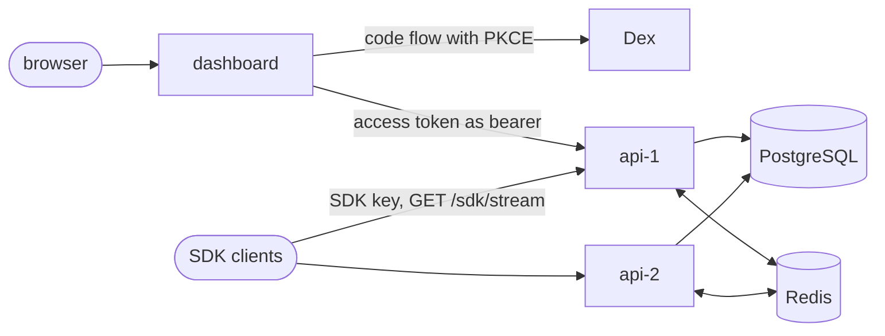

# Design

## 1. What the service promises

A tenant is a team. Its members manage boolean flags in a dashboard, and applications connect to the API with the tenant's SDK key, receive the tenant's flags over server-sent events and evaluate them locally. The service promises five things:

- **Evaluation is a function of the flag and the user.** A flag's result for a user depends only on the flag (key, enabled, salt, rules, percentage), the user's key and the attributes that the flag's rules read. It is the same in every process, the SDK's and the API's included.
- **A rollout is sticky.** With the rules unchanged, raising a flag's percentage only adds users, and lowering it and raising it again gives back the same users.
- **Every save has the next version.** Each flag write raises its tenant's version by one, in the write's own transaction, so the versions of a tenant have no gaps and each one names exactly one change. A read that starts after a save has answered returns that version or a later one.
- **A connected client ends on the latest flags.** An SDK client applies a snapshot only when its version is above the one it holds, so its version never goes back. Each snapshot holds all of the tenant's flags at one version, so a client that missed versions needs only the next one, and it can skip versions: there is no ordered change log.
- **Tenants cannot read each other's rows.** The API reads and writes as a database role that row-level security applies to, inside a transaction set to the tenant of the request. A request for another tenant's resource gets the same answer as a request for one that does not exist. The audit ids come from one sequence that all tenants share, so the gaps between a tenant's ids show how many rows other tenants wrote ([section 14](#14-limits)).

How fast a change arrives is not promised. [evidence.md](evidence.md#13-latency) has what was measured on one laptop.

## 2. Components and stack

| Part | What it is | Built on |
|---|---|---|
| `packages/core` (`@rff/core`) | Flag types, validation, MurmurHash3, bucketing and `evaluate()`. Pure functions, no I/O | TypeScript 6.0.3 |
| `packages/sdk` (`@rff/sdk`) | `FlagsClient`: the stream connection, its own server-sent events parser, local evaluation through `@rff/core` | `fetch` in Node 24.13.0 |
| `apps/api` (`@rff/api`) | The HTTP API, the stream, the SQL migrations and their runner, the demo seed | NestJS 12.1.3 on Express 5.2.1, pg 8.23.1, node-redis 6.3.0, jose 6.2.12 |
| `apps/dashboard` (`@rff/dashboard`) | Sign-in, the tenant list, a tenant's flags and its audit log | Next.js 16.4.1 App Router, React 19.3.0, openid-client 6.8.8, jose 6.2.12 |
| `tools/latency` (`@rff/latency`) | Times saves on the local stack to the last of many SDK clients, and renders the README table | `@rff/sdk` |

The stores are PostgreSQL 18.6 and Redis 8.10.2, and the identity provider is Dex v2.46.0. The packages, the API and the latency tool build with `tsc` to `dist` and run with `node` on it; the dashboard builds with `next build`. Core builds first, then the SDK, the API and the dashboard. The API and dashboard images are built on `node:24.13.0-alpine`, pinned by digest, and run as user 1000.



PostgreSQL holds every fact. Redis carries change notifications between the replicas and caches snapshots, and nothing in it has to survive a restart ([section 8](#8-notifications-the-safety-poll-and-the-cache)).

## 3. Flags, rules and rollout

The types are in [`types.ts`](../packages/core/src/types.ts):

```
Flag    = { key, enabled, salt, rules: Rule[], rolloutBasisPoints }
Rule    = { attribute, operator: 'equals' | 'in', values: string[], serve: boolean }
Context = { key, attributes?: Record<string, string> }
```

[`evaluate(flag, context)`](../packages/core/src/evaluate.ts) returns a value and the branch that gave it:

1. A disabled flag gives `false`, reason `disabled`.
2. Otherwise the rules are tried in order. The first rule whose attribute is an own property of the context's attributes and whose operator matches gives its `serve` value, reason `rule`, with its index. `equals` compares with its one value and `in` with each value of its list. Comparison is exact string equality: no case folding, trimming or Unicode normalization.
3. Otherwise the user's bucket decides: `bucket = MurmurHash3_x86_32(UTF-8 of key + "." + salt + "." + userKey, seed 0) mod 10000`, and the value is `bucket < rolloutBasisPoints`, reason `rollout`, with the bucket.

A basis point is 0.01 percent of users, so 0 lets nobody in by rollout and 10000 everybody. The hash ([`murmur3.ts`](../packages/core/src/murmur3.ts)) is the x86 32-bit variant of SMHasher's MurmurHash3 in integer arithmetic (`Math.imul`, `>>> 0`) over the bytes that `TextEncoder` gives, so a lone surrogate hashes as U+FFFD. Flag keys match `^[a-z0-9][a-z0-9_-]{0,63}$` and salts `^[0-9a-f]{16}$`, so neither contains the "." that separates the parts.

The salt is what makes a rollout sticky. The API draws it, 8 random bytes in hex, when the flag is created. A POST body that sets it and a PUT body that names a key or a salt get 400, and `rff_app` holds no UPDATE on the column. A user's bucket for a flag therefore never changes, and a percentage is a threshold on it: raising it only adds buckets, and lowering and raising it again gives the same set. The salt differs from flag to flag, so a user's bucket in one flag does not set its bucket in another.

[`validateFlag` and `validateContext`](../packages/core/src/validation.ts) refuse unknown properties and bound the input: at most 100 rules, 1000 values in an `in` rule, 100 attributes in a context, 1024 UTF-16 code units in a string, and 65,536 bytes of UTF-8 in a flag's JSON. The API validates request bodies with them, and the SDK validates every flag of every snapshot it receives.

## 4. Tenancy in PostgreSQL

### 4.1 Roles

Migration [0001](../apps/api/migrations/0001_roles.sql) creates two roles. `rff_owner` never logs in and owns every table, type and function. `rff_app` is the role the API connects as: LOGIN, NOSUPERUSER, NOBYPASSRLS, owning nothing. Its password comes from the runner's setting `rff.app_password` (`RFF_APP_DB_PASSWORD`), so no secret is in a migration file. Roles belong to the whole server, and every test run applies 0001 to a database of its own, so the file creates a role only when it is missing, under a lock on `pg_authid` that makes concurrent runs take turns. The database superuser applies the migrations; the API never connects as it.

At start-up the API reads its own role from the catalogue and refuses to start when it is a superuser, has BYPASSRLS, owns the database, a schema or any table, view, materialized view, sequence or foreign table, or is a member of a role that is or does any of these, since a member can `SET ROLE` to it ([`role-check.ts`](../apps/api/src/database/role-check.ts)). A superuser and a BYPASSRLS role skip row-level security, and an owner can turn it off or drop what it owns.

### 4.2 Tables and policies

Migration [0002](../apps/api/migrations/0002_tenancy.sql) creates six tables:

| Table | Holds | Unique |
|---|---|---|
| `tenants` | id, slug, name, `version` | slug |
| `users` | id, the identity provider's issuer and subject, email, name | (issuer, subject) |
| `memberships` | tenant, user, role (`viewer` < `editor` < `owner`) | (tenant, user) |
| `flags` | tenant, key, enabled, salt, rules as `jsonb`, `rollout_bp`, `updated_at` | (tenant, key) |
| `sdk_keys` | id, tenant, SHA-256 of the key, created, revoked | key hash |
| `audit_log` | identity id, tenant, actor's user id, action, target, before and after as `jsonb`, version, time | id |

Every table has row-level security enabled and forced, so it applies to the owner as well. Each tenant table has a policy `tenant_isolation` for every command, with the same expression in `USING` and `WITH CHECK` (on `tenants` the column is `id`):

```sql
tenant_id = NULLIF(current_setting('app.tenant_id', true), '')::uuid
```

On a connection that never set `app.tenant_id`, `current_setting(..., true)` is NULL. On a pooled connection reused after a transaction that set it, it is the empty string. `NULLIF` turns both into NULL, which no row's tenant equals, so a query without a tenant reads nothing and writes nothing.

`users` has no tenant. Its policy `self_or_co_member` shows the current user (`app.user_id`) and the members of the current tenant, which the member list needs, and no other user. Migration [0004](../apps/api/migrations/0004_personal_data.sql) adds the two narrow write policies of [section 11](#11-personal-data).

`rff_app`'s grants follow the routes: SELECT where a route reads, INSERT on `flags`, `sdk_keys` and `audit_log`, DELETE on `flags` and (since 0004) `memberships`, and UPDATE only on named columns: a tenant's `version`, a member's `role`, a flag's `enabled`, `rules`, `rollout_bp` and `updated_at`, and the four identity columns of `users`. No UPDATE reaches a `tenant_id` or a salt. There is no TRUNCATE, no privilege on a sequence (the audit id is an identity column), no CREATE on the schema and no TEMPORARY on the database, which a new database grants to PUBLIC and 0002 revokes.

### 4.3 withTenant

Every read and write of tenant data goes through `TenantDatabase.withTenant({ tenantId, userId }, fn)` ([`tenant-database.ts`](../apps/api/src/database/tenant-database.ts)). It checks out one pooled connection, runs `BEGIN`, then

```sql
SELECT set_config('app.tenant_id', $1, true), set_config('app.user_id', $2, true)
```

then `fn`, then `COMMIT`, or `ROLLBACK` when `fn` throws, and releases the connection in `finally`, discarding it when it failed. The third argument `true` scopes both settings to the transaction, so nothing survives into the connection's next use. Four details close gaps that the plain pattern leaves:

- `fn` gets a client that can only query. Once `fn` has returned or thrown, a query on it is refused, because a query that `fn` started without awaiting would otherwise run in the next caller's transaction on that connection.
- A `COMMIT` that Postgres answers with `ROLLBACK`, which happens when `fn` caught a failed statement and returned, rejects instead of passing for a commit.
- Ids that are not UUIDs are refused before a connection is taken.
- A connection that fails while checked out is released with its error, so the pool closes it.

`withUser` runs the same way with `app.tenant_id` empty, for routes about the signed-in user and no tenant. The statements on tenant tables name their tenant as well; row-level security is what holds when one does not.

### 4.4 Look-ups before the tenant is known

Three questions are asked before a tenant is set: which user a token's issuer and subject name, what role a user has in the path's tenant, and which tenant an SDK key belongs to. A fourth lists a user's tenants for `GET /me` (migration [0003](../apps/api/migrations/0003_memberships_of_user.sql)). Each is a `SECURITY DEFINER` function owned by `rff_owner`, with `search_path` fixed to `pg_catalog, pg_temp` and an SQL-standard body parsed at creation. Each returns one value for its arguments and nothing about any other row, reads no setting, is `STRICT`, and is executable by `rff_app` and not by PUBLIC. Policies named `lookup_by_owner` let `rff_owner` read the rows these functions search.

### 4.5 Migrations

Migrations are plain SQL files `apps/api/migrations/NNNN_name.sql` applied in order by [`migrator.ts`](../apps/api/src/migrator.ts), with no ORM. Each file runs in one transaction with the row that records it in `schema_migrations`, with its SHA-256. A recorded file whose bytes changed, a gap in the numbers or a database migrated by a newer release stops the run. A session-level advisory lock makes two runners on one database take turns.

## 5. Tokens, roles and SDK keys

### 5.1 Bearer tokens

The API verifies a bearer token with jose: `createRemoteJWKSet` on `RFF_AUTH_JWKS_URL`, then `jwtVerify` with the issuer `RFF_AUTH_ISSUER`, the audience `RFF_AUTH_AUDIENCE` (`rff-api`), the algorithms RS256 and ES256, and `sub` and `exp` required ([`token-verifier.ts`](../apps/api/src/auth/token-verifier.ts)). The issuer and the key set are separate settings because they are different addresses for one provider: tokens name the address browsers use, `http://127.0.0.1:5556/dex`, and inside the compose network the key set is at `http://dex:5556/dex/keys`. A token fault gives 401; a key set that cannot be fetched gives 503 and lets no request through.

A verified token names a user through `user_id_for_subject(issuer, subject)`. A token for a pair that is not in `users` gets the same 401 as an invalid one. Dex's access token is a JWT whose `aud` lists `rff-api` through cross-client trust ([section 10](#10-the-dashboard-and-sign-in)), and its `sub` encodes the user's `userID` and the connector id `local`, which the seed computes the same way ([`dex-subject.ts`](../apps/api/src/seed/dex-subject.ts)).

### 5.2 Access levels

Every route handler declares its access with `@Access` ([`access.ts`](../apps/api/src/auth/access.ts)): `public`, `signed-in`, a minimum role (`viewer`, `editor`, `owner`) in the tenant of the path, or `sdk-key`. A handler without a declaration stops start-up and is named in the error ([`route-access-check.ts`](../apps/api/src/auth/route-access-check.ts)). One guard runs before every handler ([`access.guard.ts`](../apps/api/src/auth/access.guard.ts)) and answers in this order:

1. No token, an invalid one, or one for an unknown user: 401 with `WWW-Authenticate: Bearer`.
2. Not a member of the path's tenant, a tenant that does not exist, or a path tenant that is not a UUID: 404, the same body and headers as a missing resource.
3. A member below the route's role: 403.

The tenant comes from the path `/tenants/:tenantId/...` only, never from a body, a header or a token claim. The role is read from `memberships` through `member_role_in_tenant` on every request. Tokens carry no role and nothing caches memberships, so a role change applies to the next request.

| Route | Access | What it does |
|---|---|---|
| `GET /health` | public | Answers 200 with the replica's name when the database answers |
| `GET /me` | signed-in | The user, and each of its tenants with slug, name and role |
| `GET /me/export` | signed-in | The user's personal data ([section 11](#11-personal-data)) |
| `DELETE /me` | signed-in | Erases it and leaves every tenant |
| `GET /tenants/:tenantId/flags` | viewer | The tenant's version and flags |
| `GET /tenants/:tenantId/flags/:flagKey` | viewer | One flag |
| `POST /tenants/:tenantId/flags` | editor | Creates a flag; the server sets the salt |
| `PUT /tenants/:tenantId/flags/:flagKey` | editor | Replaces enabled, rules and percentage |
| `DELETE /tenants/:tenantId/flags/:flagKey` | editor | Deletes a flag |
| `POST /tenants/:tenantId/evaluate` | viewer | Every flag evaluated for a context, at one version |
| `GET /tenants/:tenantId/audit` | viewer | 100 audit rows, newest first; `?before=<id>` pages |
| `GET /tenants/:tenantId/members` | viewer | Members with email, name and role |
| `PUT /tenants/:tenantId/members/:userId` | owner | Changes a member's role |
| `POST /tenants/:tenantId/sdk-keys` | owner | Creates an SDK key and returns it once |
| `GET /sdk/stream` | SDK key | The tenant's snapshots ([section 7](#7-the-stream)) |

### 5.3 SDK keys

An SDK key is `rff_sdk_` and 32 random bytes in base64url ([`sdk-keys.controller.ts`](../apps/api/src/sdk-keys/sdk-keys.controller.ts)). The response holds the key once; the database holds its SHA-256, which is unique across tenants, and the audit row names the key by id only. On `GET /sdk/stream` the guard hashes the key and asks `tenant_id_for_sdk_key`, which ignores revoked keys, on every request. A missing, malformed, unknown or revoked key, and a user's token, get the same 401.

## 6. Writes, versions and the audit log

Each flag write is one `withTenant` transaction in this order ([`flags.service.ts`](../apps/api/src/flags/flags.service.ts)):

1. `UPDATE tenants SET version = version + 1 WHERE id = $1 RETURNING version`. The row lock it takes makes the writers of one tenant commit one after another, so their versions are consecutive.
2. The change: an `INSERT ... ON CONFLICT DO NOTHING`, where no row back means a duplicate key and 409; a read of the flag, 404 when it is missing, then an `UPDATE` of enabled, rules and percentage; or a `DELETE`, where no row back means 404.
3. The audit row, carrying the new version.

A failure anywhere rolls all three back, so a refused write leaves no version, no audit row and no notification. After `COMMIT` the replica deletes the cache entry of the version before and publishes the change ([section 8](#8-notifications-the-safety-poll-and-the-cache)), both at once. Neither can fail the write: the cache logs its own failures, and a failed publish is logged as a warning. The response is sent once both have settled.

A snapshot is `{ tenantId, version, flags }` with the flags ordered by key in byte order. It is read by one statement, `tenants LEFT JOIN flags` ([`flag-store.ts`](../apps/api/src/flags/flag-store.ts)), so its flags are exactly those of its version. `GET /flags` and `POST /evaluate` read it through the cache; `POST /evaluate` runs `evaluate()` from `@rff/core` on each flag for the context in the body and returns `{ version, results }`, for clients that cannot run the SDK.

Every route that changes data writes its audit rows in the change's own transaction ([`audit-log.ts`](../apps/api/src/audit/audit-log.ts)): one row for `flag.create`, `flag.update`, `flag.delete`, `member.role` and `sdk_key.create`, and one `member.leave` row for each tenant that `DELETE /me` leaves. A row names its actor by user id only, never by name or email, and holds the before and after states. `rff_app` holds only INSERT and SELECT on `audit_log`, so the API cannot change or remove a row. Member and SDK key changes write an audit row with no version and leave the tenant's version alone: the version counts flag changes, which is what SDK clients follow.

`PUT /members/:userId` locks the tenant's row (`FOR NO KEY UPDATE`), changes the role, counts the owners and answers 409 when none is left, so two owners who demote each other at once leave one.

## 7. The stream

`GET /sdk/stream` is a Nest `@Sse()` route ([`stream.controller.ts`](../apps/api/src/stream/stream.controller.ts)). Each data event is

```
id: <version>
event: snapshot
data: {"tenantId": ..., "version": ..., "flags": [...]}
```

and a heartbeat is the comment frame `: hb`, with no id, every `RFF_STREAM_HEARTBEAT_MS` (15 s by default). Nest gives a data event without an id one of its own, so every data event sets it. The client's cursor is `Last-Event-ID`, else `?cursor=`, else none, and anything that is not a version gets 400 before a stream opens.

The fan-out on one replica is [`StreamHub`](../apps/api/src/stream/stream-hub.ts). It keeps, per tenant, the open streams and the last version each one was sent. A wake-up for a tenant reads the tenant's version and, when any stream is behind, the snapshot, and sends one serialized event to every stream of the tenant that is behind. Four things wake a tenant:

| Cause | When |
|---|---|
| `connect` | A stream opens. A client whose cursor is below the tenant's version gets the snapshot at once |
| `notification` | A change message for the tenant arrives from Redis |
| `ready` | The replica's Redis subscriber is ready again after a lost connection: every tenant with open streams |
| `poll` | The safety poll: every tenant with open streams |

At most one read runs per tenant. A wake-up that arrives during a read marks the tenant, and exactly one more read follows however many arrived, so no wake-up is dropped and none multiplies the reads. A failed read is logged, and the next wake-up reads again. A read is two short `withTenant` transactions at most; no stream holds a pooled connection or a transaction between reads or for its life. When the latest wake-up that asked for a read was not a notification, the replica logs what the read sent, with the version, tenant, stream count and cause; `tools/latency` counts these lines.

At shutdown (`enableShutdownHooks`, `forceCloseConnections: true`) the hub completes every open stream through `takeUntil`, waits for running reads and gives the ends one turn of the event loop to reach the sockets, so clients see the stream end and not a reset.

## 8. Notifications, the safety poll and the cache

**Notifications.** [`ChangeBus`](../apps/api/src/stream/change-bus.ts) publishes `{tenantId, version}` on `<prefix>:changes` after a write commits, and every replica, the writer included, subscribes on a second connection and wakes its streams of that tenant only. The message says which tenant to read; the streams get what the read finds. A message that is not a change is ignored. Pub/sub delivers a message at most once and not at all to a subscriber that is disconnected, so when node-redis reports the subscriber ready again, after the subscription is renewed, the replica wakes every tenant it has open streams for.

**The safety poll.** Every `RFF_SAFETY_POLL_MS` (5 s by default, 30 s in `compose.yaml`) each replica wakes every tenant it has open streams for ([`safety-poll.ts`](../apps/api/src/stream/safety-poll.ts)). A tenant whose streams are up to date costs one read of its version. A change whose notification was lost reaches an open stream at the next round, and a client that reconnects gets it from the read when its stream opens. Correctness never depends on Redis.

**The connections.** Start-up waits for Redis until `RFF_REDIS_CONNECT_DEADLINE_MS` (30 s), as it waits for Postgres. After that a lost connection is retried without end, with backoff from 50 ms doubling to at most 2 s. Commands time out after 2 s and, while a connection is down, fail at once instead of queueing ([`redis-connection.ts`](../apps/api/src/redis/redis-connection.ts)): a cache read goes to Postgres and a publish that fails is logged.

**The cache.** [`FlagsCache`](../apps/api/src/flags/flags-cache.ts) holds snapshots under `<prefix>:flags:<tenantId>:v<version>` for 3600 s. [`SnapshotReader`](../apps/api/src/stream/snapshot-reader.ts) reads in this order:

1. The tenant's current version, from Postgres in a short transaction.
2. The cache entry of that version, used only when it names the tenant and the version asked for.
3. Otherwise the snapshot from Postgres in one statement, which goes into the cache only when its version is the one read in step 1.

A version's flags never change once it has committed, and an entry is written only from a one-statement snapshot, so an entry can be missing but not stale, as long as no version number is used twice ([section 14](#14-limits)). A read that starts after a save has committed reads that version or a later one in step 1, with the cache warm or cold. A write deletes the entry of the version before it, and the expiry removes an entry that a read wrote after that delete. Every Redis failure counts as a miss.

Every key and channel starts with `RFF_REDIS_PREFIX` and ":" (`rff` by default). Replicas that serve one database share the prefix; each test run and each test environment has its own.

## 9. The SDK

[`FlagsClient`](../packages/sdk/src/client.ts) takes the API's URL and an SDK key and connects at once. It exposes `version` (null before the first snapshot), `flags`, `evaluate(flagKey, context)`, which runs `evaluate()` from `@rff/core` on the flag it holds or returns undefined, `onChange(listener)` and `close()`. It has no ready promise: a caller that needs a version waits for `onChange` at or above it.

- **Transport.** `fetch` with its own parser for server-sent events ([`sse-parser.ts`](../packages/sdk/src/sse-parser.ts)), because Node 24 has no global `EventSource` and a browser's cannot send an `Authorization` header. The parser handles LF, CRLF and CR line ends, events cut anywhere across chunks, a UTF-8 sequence split between chunks, a byte order mark and the newline Nest writes with the headers.
- **The version rule.** A snapshot is applied only when its version is greater than the one held. On every reconnect the client sends the version it holds as `Last-Event-ID`.
- **What it refuses.** Data that is not JSON, a flag that `validateFlag` refuses, a duplicate key, an event id that is not the snapshot's version and a snapshot of another tenant are reported through `onError` and not applied.
- **Dead connections.** A connection that delivers no bytes for three heartbeat intervals (45 s at the default 15 s) is aborted and replaced, since a peer that vanished never reports an error.
- **Backoff.** The wait before attempt n is drawn between half and all of `min(30000, 1000 × 2^n)` ms, and the count starts over once a connection opens. After 400, 401, 403 or 404, which a retry cannot change, the client stops.

## 10. The dashboard and sign-in

The dashboard is a Next.js App Router app with standalone output. Only its server calls the API, with the signed-in user's access token as bearer ([`api.ts`](../apps/dashboard/lib/api.ts)); the browser never calls the API and never holds the token. Its pages are the user's tenant list, a tenant's flags and a tenant's audit log. Editors and owners can switch a flag on or off and change its percentage; viewers see the same controls, disabled.

**Sign-in** is the authorization code flow with PKCE through openid-client ([`oidc.ts`](../apps/dashboard/lib/oidc.ts)). `GET /auth/login` draws a state, a nonce and a code verifier, keeps them in the flow cookie and sends the browser to Dex with an S256 challenge and the scope `openid email profile audience:server:client_id:rff-api`. That scope, with `trustedPeers: [rff-dashboard]` on the `rff-api` client in Dex, puts `rff-api` in the token's audience. `GET /auth/callback` checks the state, exchanges the code with the verifier, checks the ID token's issuer, audience and nonce, sets the session cookie and deletes the flow cookie. Any failure answers 400 with its reason and sets no session. `POST /auth/logout` deletes the session cookie. It answers 403 and keeps the cookie when the request's `Origin` is not the dashboard's, since the route needs no cookie and a form on any site could otherwise sign the user out.

Discovery runs on the issuer as tokens name it, `http://127.0.0.1:5556/dex`, with a fetch that sends every request for that origin to `http://dex:5556` inside the compose network; discovery on the internal address fails openid-client's issuer comparison. Plain HTTP is allowed only for an issuer on a loopback address.

**Cookies** ([`cookies.ts`](../apps/dashboard/lib/cookies.ts)). Both are encrypted JWTs (JWE, `dir` with A256GCM), httpOnly and SameSite=Lax, each with its own key derived from `RFF_SESSION_SECRET` with HKDF-SHA256 and its own `typ`, so neither opens as the other. `rff_session` holds the access token and the name and email the pages show, and expires with the token. `rff_auth_flow` holds the state, nonce and verifier, is sent only to `/auth/callback` and lives 600 s.

**The flag form** posts to a server action, `saveFlag` ([`flag-actions.ts`](../apps/dashboard/lib/flag-actions.ts)). Anyone can send that POST, so the action checks the session and the fields itself, reads the user's role in the tenant from `GET /me`, and answers a tenant the user is not in as one that does not exist. For an editor or owner it reads the flag and sends `PUT` with the new enabled and percentage and the flag's rules unchanged, as the user, and the API checks the role again.

**Dex** ([`local-demo-config.yaml`](../dex/local-demo-config.yaml)) keeps its storage in memory, enforces S256 PKCE for every client, offers the code and refresh grants and no password grant, and has four static users, each with a `userID`. A static user without one would get the subject of an empty id, shared with every other such user.

## 11. Personal data

A dashboard user's personal data is the issuer, subject, email and name in `users`, and the user's memberships ([`personal-data.ts`](../apps/api/src/me/personal-data.ts)). Audit rows hold the user's id and no personal field.

**Export.** `GET /me/export` reads the user's row and `memberships_of_user` in one statement under `withUser`, and returns every column of `users` with its value. A column that is neither in the export nor on a named exclusion list, which is empty, fails a test.

**Deletion.** `DELETE /me` runs in one transaction through `withUserAcrossTenants`, which enters each of the user's tenants with `app.tenant_id` set to it, one step at a time, only while the user is a member, and rolls the whole transaction back when a step throws:

1. Lock the user's row (`FOR NO KEY UPDATE`). An erased user gets 401, so the second of two deletions at once finds the user gone.
2. In each tenant, in tenant id order so that two deletions that share tenants cannot deadlock: lock the tenant's row as `PUT /members` does, count its owners, answer 409 when the user is its only owner, delete the membership and write a `member.leave` audit row with the former role.
3. Set the four identity columns to NULL and keep the row and its id.

Migration 0004 makes the four columns nullable together (`CHECK num_nulls(...) IN (0, 4)`) and gives `rff_app` two narrow write policies: `erase_self`, which lets an UPDATE reach only the current user's row and only to set the four columns to NULL, and the restrictive `leave_self`, which lets a DELETE on `memberships` reach only the current user's membership in the current tenant. `user_id_for_subject` compares with `=`, which no NULL passes, so after the deletion the user's token, still valid at Dex, gets 401.

## 12. The local stack

`compose.yaml` runs, all published on 127.0.0.1:

| Service | Port | What it does |
|---|---|---|
| `postgres` | 55432 | PostgreSQL 18.6 with `max_connections=300`, for test runs that share it |
| `redis` | 56379 | Redis 8.10.2 with no persistence |
| `migrate` | | Builds the API image, applies the migrations as the superuser and exits 0 |
| `seed` | | Writes the demo data as the superuser and exits 0 |
| `dex` | 5556 | Dex v2.46.0 |
| `api-1`, `api-2` | 4001, 4002 | Two replicas from one YAML anchor, with only `rff_app`'s credentials |
| `dashboard` | 3100 | The dashboard, calling `api-1` |

Every long-running service has a healthcheck, and the dependent ones wait with `service_healthy` or `service_completed_successfully`, so `docker compose up --build --detach --wait` returns when the stack is ready. Every container but PostgreSQL's and Redis's runs read-only. The replicas share one Redis prefix and run the safety poll every 30 s, so that `scripts/demo.sh` can show that a change reaches the other replica by notification: it saves two changes on `api-1`, the second 3 s after the first arrived, and requires each on an SDK stream of `api-2` within 2 s. With a 30 s poll, at most one poll round can fall inside those two windows, so at least one of the two changes must arrive by notification.

The seed ([`demo-data.ts`](../apps/api/src/seed/demo-data.ts)) writes two tenants, acme and globex, the four Dex users by issuer and subject with fixed ids, five memberships, five flags and one SDK key per tenant. A run changes nothing that is already there: it inserts a tenant only when its id and slug are free, gives memberships, flags and a key only to the tenants it inserted, and leaves a user that erased itself erased. Every credential, password and SDK key in the stack is a local demo value published with the repository.

## 13. Rejected alternatives

- **A tenant filter in every query as the only boundary.** One forgotten filter would leak. With row-level security a query without a filter still reads one tenant, and the start-up check keeps the API off any role that skips it. The queries keep their filters as well.
- **A session-level setting of the tenant.** It survives `COMMIT` on a pooled connection and reaches the next request on it.
- **Roles in the token, or a membership cache.** A removed member would keep access until the token or the entry expired.
- **An ordered change log with replay from a cursor.** A client needs only the latest flags, and a snapshot gives it them in one event whatever it missed. A log would need retention and compaction, and a client that fell behind it would need the snapshot anyway.
- **Redis as the source of truth.** Pub/sub drops messages for a subscriber that is away. PostgreSQL `LISTEN`/`NOTIFY` would drop them the same way and hold a connection per replica outside the pool. Either way a poll is needed, so the notification is only a hint about which tenant to read.
- **A cache key per tenant, deleted on every write.** A read that started before a write can put the old snapshot back after the delete. With the version in the key and the version read from Postgres first, an old entry is never read while versions only grow.
- **Evaluation on the server for every check.** Each check would be a request. The SDK evaluates locally with the same package the API uses, and `POST /evaluate` remains for clients that cannot.
- **A password grant, or a test-only client, in Dex.** Dex cannot limit grant types per client, so with the password grant any client could trade a password for a token. The demo and the latency tool drive the code flow with curl instead.
- **An ORM.** The policies, grants and look-up functions are SQL, and so are the statements whose order matters, such as the version bump.

## 14. Limits

- **Clients can skip versions.** Each event is a whole snapshot, and there is no history of intermediate versions.
- **Every change sends every flag.** A change sends the tenant's whole snapshot to each of its streams, and nothing limits the number of flags in a tenant.
- **No stream limit.** Nothing limits the streams per SDK key or per tenant.
- **A revoked key's stream stays open.** The key is checked when a stream opens, so a stream open when its key is revoked stays open until it reconnects. There is also no route that revokes or lists keys.
- **A hung Redis command delays a write.** The response to a flag write waits for the cache delete and the publish, which run at once, so a Redis that does not answer delays it by up to the 2 s command timeout.
- **A dead cache entry can stay.** A read that misses, reads a snapshot and stores it after a newer write deleted that version's entry leaves one entry that nothing reads, until its expiry of an hour.
- **A database restore needs Redis flushed and SDK clients restarted.** The cache, the stream and the SDK take a version number to name one set of flags for all time. After PostgreSQL is restored or reset to an earlier version while Redis and the clients keep running, the cache can serve the old snapshot of a reused version for up to an hour, a stream whose cursor is above the tenant's version gets only heartbeats, and a client that holds a higher version ignores the tenant's snapshots until the versions pass it.
- **Audit ids show other tenants' activity.** The ids come from one identity sequence shared by all tenants, so the gap between two of a tenant's ids is the number of audit rows other tenants wrote in between.
- **A request past the guard completes.** The guard checks the role before the handler's transaction, so a request that passed it just before a role was lowered or a membership removed still completes.
- **No precondition on PUT.** A PUT replaces the flag's settings with no version check. The dashboard reads a flag and puts its rules back unchanged, so a rule edit made through the API between that read and that write is lost.
- **Deletion clears the live row only.** Old row versions stay until vacuum, and in the write-ahead log and in backups.
- **Erasure keeps the id.** The `users` row and its id stay, and audit rows keep it as actor.
- **Personal data in flag rules is out of scope.** An editor can type an email into a rule's values; export and deletion do not look there.
- **No sign-up.** Nothing creates a user at sign-in; users exist through the seed. An erased user who signs in again gets 401.
- **No dashboard page for export, deletion, members, keys, rules or new flags.** Those are API routes only. The dashboard changes enabled and the percentage.
- **No tenant creation.** No route creates a tenant; the seed does.
- **Logout is local.** It deletes the session cookie and does not end the Dex session or revoke the token, which stays valid until it expires.
- **A Dex restart signs everyone out within 10 minutes.** Dex keeps its keys in memory and makes new ones when it starts. Each replica keeps the key set it fetched for up to 10 minutes, or until a token signed with a new key makes it fetch again, and after that no earlier token verifies.
- **A token for an unknown user is not logged.** The API answers 401 and logs nothing when a verified token matches no user.
- **Plain HTTP.** The stack serves everything over HTTP on the loopback address, so the dashboard's cookies are not marked `Secure`.
- **The SDK has run only in Node 24.** In a browser it would also show the tenant's SDK key to every user.
- **No browser tests.** No test renders a page in a browser: the dashboard's route handlers, cookies, API client and server action run in Vitest outside Next.js, and `scripts/demo.sh` drives the sign-in with curl.
- **No rate limits.**
- **No high availability or deployment.** One PostgreSQL and one Redis serve the stack, and it has run on one laptop and in CI.
